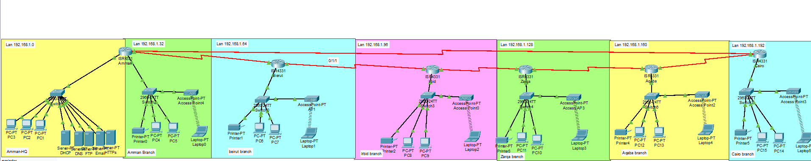
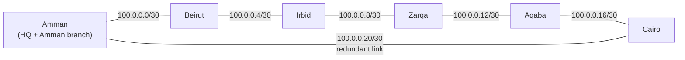
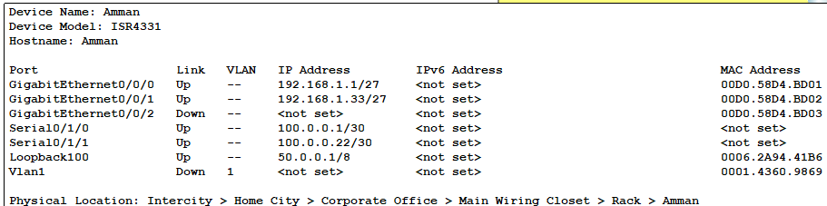
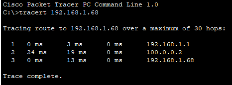
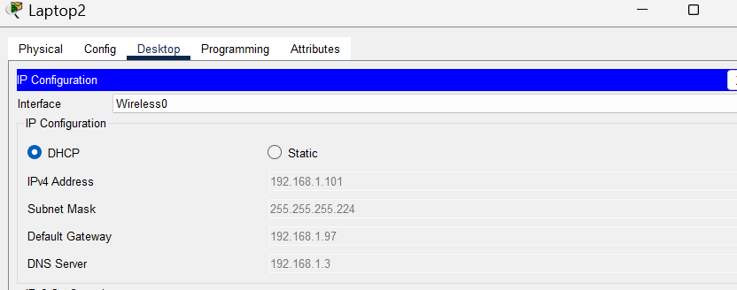
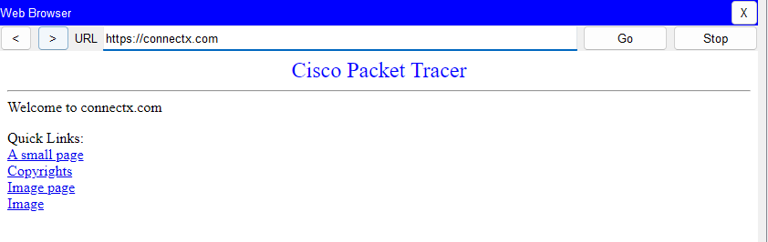
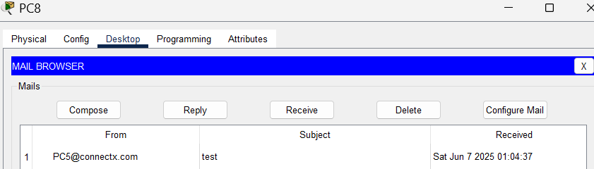
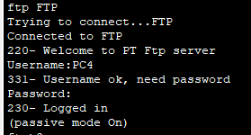

# ConnectX Enterprise Network

Design and implementation of a multi-site enterprise network for a fictional company, ConnectX, built in **Cisco Packet Tracer**. The network connects a headquarters and six branches across Jordan, Lebanon and Egypt, with centralized servers, dynamic addressing, routing between all sites, and wireless access at every branch.




## Overview

| | |
|---|---|
| **Sites** | Amman HQ, Amman, Beirut, Irbid, Zarqa, Aqaba and Cairo branches |
| **Routers** | 6 x Cisco ISR4331, linked by serial WAN connections |
| **LAN** | Cisco 2960 switches, PCs, printers, and a WPA2 wireless access point per branch |
| **Servers** | DHCP, DNS, FTP, Email and HTTPS, centralized at Amman HQ |
| **Routing** | RIP version 2, plus default routes towards headquarters |
| **Addressing** | `192.168.1.0/24` split into `/27` LANs; `100.0.0.0` split into `/30` WAN links |

## WAN topology

Each router connects to its two neighbors, forming a ring. The **Cairo to Amman** link acts as the redundant path: Cairo is the furthest site from headquarters, so if any single link in the chain fails, traffic can still reach Amman HQ the other way around.



## IP addressing

### LAN subnets

Each site needs up to 30 hosts. Using 2<sup>n</sup> - 2 &ge; 30 gives **n = 5 host bits**, so each LAN is a **/27** (`255.255.255.224`). This splits `192.168.1.0/24` into 8 subnets: 7 in use and 1 left free for a future branch.

| Site | Network | Usable range | Broadcast | Default gateway |
|---|---|---|---|---|
| Amman HQ | 192.168.1.0/27 | .1 to .30 | 192.168.1.31 | 192.168.1.1 |
| Amman branch | 192.168.1.32/27 | .33 to .62 | 192.168.1.63 | 192.168.1.33 |
| Beirut branch | 192.168.1.64/27 | .65 to .94 | 192.168.1.95 | 192.168.1.65 |
| Irbid branch | 192.168.1.96/27 | .97 to .126 | 192.168.1.127 | 192.168.1.97 |
| Zarqa branch | 192.168.1.128/27 | .129 to .158 | 192.168.1.159 | 192.168.1.129 |
| Aqaba branch | 192.168.1.160/27 | .161 to .190 | 192.168.1.191 | 192.168.1.161 |
| Cairo branch | 192.168.1.192/27 | .193 to .222 | 192.168.1.223 | 192.168.1.193 |
| *Reserved* | 192.168.1.224/27 | .225 to .254 | 192.168.1.255 | Future branch |

### WAN links

Each point-to-point link needs exactly 2 addresses, so 2<sup>n</sup> - 2 = 2 gives **n = 2**, a **/30** (`255.255.255.252`).

| Link | Network | Usable IPs | Broadcast |
|---|---|---|---|
| Amman - Beirut | 100.0.0.0/30 | .1 - .2 | 100.0.0.3 |
| Beirut - Irbid | 100.0.0.4/30 | .5 - .6 | 100.0.0.7 |
| Irbid - Zarqa | 100.0.0.8/30 | .9 - .10 | 100.0.0.11 |
| Zarqa - Aqaba | 100.0.0.12/30 | .13 - .14 | 100.0.0.15 |
| Aqaba - Cairo | 100.0.0.16/30 | .17 - .18 | 100.0.0.19 |
| Cairo - Amman | 100.0.0.20/30 | .21 - .22 | 100.0.0.23 |

### Static vs. dynamic addressing

- **Static:** router interfaces, servers and printers, since other devices need to find them at the same address every time.
- **Dynamic (DHCP):** PCs and laptops, so new devices get an address automatically from their site's pool.

In each branch, the first usable IP is the router's default gateway, the second is the printer, and the DHCP pool starts after that. At HQ, `.2` to `.6` are the five servers and the DHCP pool starts at `.7`.

## Services

All servers are at Amman HQ and are reachable from every branch.

| Server | IP | Role |
|---|---|---|
| DHCP | 192.168.1.2 | Gives PCs and laptops their IP, subnet mask, gateway and DNS server. One pool per site. |
| DNS | 192.168.1.3 | Resolves `connectx.com` to the web server, so users don't need to remember IPs. |
| FTP | 192.168.1.4 | File sharing, with a username, password and permissions for each user. |
| Email | 192.168.1.5 | Internal email between employees. |
| HTTPS | 192.168.1.6 | The company website, served over an encrypted connection. |

Branch routers use **`ip helper-address`** to forward DHCP requests across the WAN to the central DHCP server, since DHCP broadcasts don't cross routers on their own.

## Routing

- **RIP version 2** shares routes between all six routers. It was chosen for its simple configuration and management on a network of this size.
- **Default static routes** on every router send non-local traffic towards Amman HQ.
- **Loopback interface** on the Amman router (`50.0.0.1/8`) gives a stable address for routing and management that never goes down.

RIP configuration on the Amman router. LAN-facing interfaces are passive so routing updates are only sent over the WAN, and auto-summary is disabled so the `/27` subnets are advertised correctly:

```
Amman(config)# router rip
Amman(config-router)# version 2
Amman(config-router)# network 192.168.1.0
Amman(config-router)# network 100.0.0.0
Amman(config-router)# passive-interface gig0/0/0
Amman(config-router)# passive-interface gig0/0/1
Amman(config-router)# no auto-summary
```

The Amman router's interfaces: two LANs (HQ and the Amman branch), two serial WAN links, and the loopback.



## Security

- Console password and encrypted **enable secret** on every router
- **WPA2** on all wireless access points
- **HTTPS** instead of HTTP for the company website

## Testing

| # | Test | Method | Result |
|---|---|---|---|
| 1 | Connectivity between LANs | `ping` from PC1 (Amman HQ) to PC10 (Zarqa), repeated across all devices | Pass |
| 2 | Email exchange | Email sent from PC5 to PC8 | Pass |
| 3 | DNS name resolution | Browsing to `connectx.com` from every PC | Fail, then fixed: the DNS record pointed to the wrong IP |
| 4 | DHCP across sites | Switching laptops and PCs from static to DHCP | Fail, then fixed: branches got APIPA addresses until `ip helper-address` was added on the routers |
| 5 | Packet route | `tracert` from PC1 to PC7 (Beirut) | Pass |
| 6 | File transfer | `ftp` command from PC4 | Pass |
| 7 | Wi-Fi connectivity | `ping` from laptops over WPA2 | Pass |

### Test screenshots

**Traceroute** from PC1 at Amman HQ to PC7 in Beirut: through the HQ gateway, across the Amman-Beirut WAN link, to the destination.



**DHCP over Wi-Fi:** Laptop2 in Irbid received its address, gateway and DNS server automatically from the central DHCP server, after `ip helper-address` was added.



**DNS and HTTPS:** the company website loads by its name, `https://connectx.com`, after the DNS record was corrected.



**Email:** a message sent from PC5 received on PC8.



**FTP:** PC4 logs in to the file server with its own username and password.



## Possible improvements

- **Full mesh WAN** so every site has a direct backup link, not just Cairo
- **OSPF instead of RIP**, choosing paths by link speed instead of hop count for lower latency
- **Stronger password policies** on routers and access points

## How to open

1. Install [Cisco Packet Tracer](https://www.netacad.com/cisco-packet-tracer) (free with a Cisco Networking Academy account).
2. Open `network-topology.pkt`.

## Author

**Lujain Naimat** · [GitHub](https://github.com/LujainNaimat)
